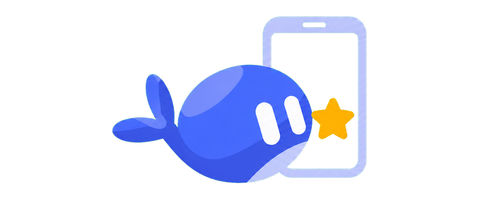
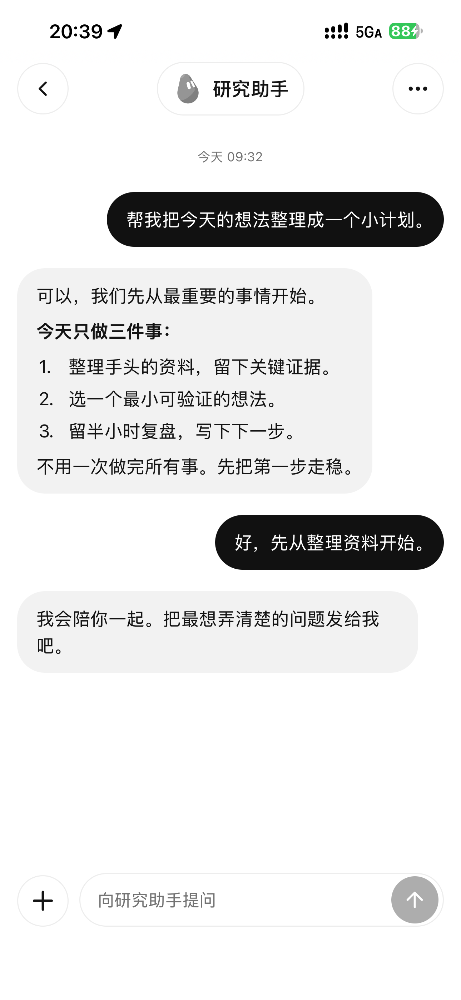

> This public repository is a cleaned source snapshot exported from original commit `748f671d267778147641800781d46b4d83ec261e`. Previous commits, PRs, release assets and CI logs were not migrated. The desktop screenshot containing chat previews was removed. Mobile and desktop components were not rebuilt or tested on devices for this publication. CI configurations are stored in `.github/workflow-templates/` and do not run automatically.

> Custom integrated source **0.1.8-codex.3** (native version 0.1.8, SDK 0.1.1-codex.4): **Bridge 0.0.9-codex.5 + companion 0.2.1-codex.4**, from the same reviewed commit. Unpublished and not deployed; retain the existing compatible engine. Includes #6/#7/#8. See [integrated delivery](docs/integrated-delivery.md), [version sources](docs/version-sources.md) and [installation](docs/installation.md). Upstream release assets below are provenance, not this custom pair.

<div align="center">

<p></p>

<h1>DS Bot Mobile App</h1>
<p>Connect to your existing Bot team from your phone, keep drafts close, and manage access per device.</p>

<p>
  <a href="https://github.com/0215eleven/ds-bot-mobile-app/actions/workflows/check.yml"></a>
  <a href="docs/status.md"></a>
  <a href="LICENSE"></a>
</p>

<p><a href="README.md">简体中文</a> · English · <a href="docs/installation.md">Install &amp; pair</a> · <a href="docs/usage.md">Usage</a> · <a href="https://github.com/MuQY1818/ds-bot-mobile-app/releases">Releases</a> · <a href="docs/README.md">Documentation</a></p>

</div>

> **Want to use your phone right away?** Start with [DS Bot Mobile Web](https://github.com/MuQY1818/ds-bot-mobile-web): browser access with no native build. This repository provides the iOS / Android client source and its desktop companion. Ready-to-install IPA/APK files are not available.

## A native interface for an existing team

Connect to DS Bot already running in [DeepSeek Harness](https://github.com/deepseek-ai/deepseek-harness) (DSH) on your computer, with your existing Bots, groups and conversations. The phone handles native navigation, reading and drafts. The desktop companion handles pairing approval and device management; the independent Bridge handles authentication and transport.

| Conversations | Direct messages | Group chat |
| :---: | :---: | :---: |
|  |  |  |

<p align="center"><sub>Historical upstream iPhone captures with synthetic conversations, showing the layout at that time. They do not establish device acceptance for this integration. See <a href="docs/status.md">status</a> for current features and device coverage.</sub></p>

<details>
<summary><strong>On the computer: Phone access → App</strong></summary>
<p>Generate a pairing QR, approve requests and revoke individual devices from one entry point.</p>
</details>

## Designed for phone use

<table>
  <tr>
    <td width="50%"><strong>Your existing conversations</strong><br>Read Bot and group text history with group authorship intact. Keep the team on the computer without recreating it on the phone.</td>
    <td width="50%"><strong>Messages made for reading</strong><br>CJK Markdown, code and tables; native iOS range selection and drag handles, with raw Markdown copy below each bubble.</td>
  </tr>
  <tr>
    <td><strong>Room for the next draft</strong><br>Sending immediately creates a pending bubble and frees the composer. Uncertain or failed requests retain their content for status checks and explicit retries.</td>
    <td><strong>Access per device</strong><br>The computer owner approves pairing and can revoke a device. The companion and Bridge have separate lifecycles; Bridge retains device authorization.</td>
  </tr>
</table>

Also included: English/Chinese interfaces, light and dark themes, character avatars, recent conversation caching and a return-to-latest button. Cached content and drafts remain available offline. Messaging requires the computer, Bridge and network; reconnecting does not automatically send drafts.

### Current capabilities

| Scope | Current behavior |
| --- | --- |
| Text conversations | Bot / group text history, complete replies, send confirmation and status queries |
| Host capabilities | Models, usage, memory, schedules and queues are available according to host capability discovery |
| Team management | Create Bots and groups, plus supported Bot / group management actions, when the host exposes those capabilities and the team is writable |
| Not provided yet | Adding Agents, token deltas, native tool approvals, media/voice transport and system push notifications |
| Platforms | iOS / Android source candidate; no mobile build or device acceptance in this integration. Earlier upstream iPhone records remain historical evidence |

A visible control does not establish Bridge support. See [status](docs/status.md) and the [capability and validation matrix](docs/validation.md) for the complete scope.

## Three components, separate responsibilities

| Project | Runs on | Responsibility | Best fit |
| --- | --- | --- | --- |
| [Mobile Web](https://github.com/MuQY1818/ds-bot-mobile-web) | Computer DSH; accessed by a phone browser | Mobile Web interface, browser sign-in and history browsing | Users who want phone access immediately |
| **Mobile App** · this repository | Native client on the phone; companion in computer DSH | Native interaction, drafts and cache; desktop pairing approval and device management | Developers able to build a native client |
| [Mobile Bridge](https://github.com/MuQY1818/ds-bot-mobile-bridge) | Computer DSH | App device identity, HTTP/WS transport, capability adaptation and authorization storage | Native-client deployments |

All three reuse an existing DSH / DS Bot team. Web, the App companion and Bridge are independently installed desktop plugins; the native App is a phone client. **Web requires neither App nor Bridge. The native App does not require Web.** Disabling the pairing interface does not revoke devices or stop Bridge. See [plugin responsibilities and lifecycle](docs/plugins.md).

### Upstream historical versions and deliverables

| Deliverable | Historical upstream version | Historical distribution |
| --- | --- | --- |
| App source preview | `0.1.7-preview.1` | Upstream repository and [release](https://github.com/MuQY1818/ds-bot-mobile-app/releases/tag/v0.1.7-preview.1) |
| Native client | `0.1.7` | Build with your own platform toolchain; no public IPA/APK |
| Desktop App companion | `0.2.0` | [`ds-bot-mobile-app-0.2.0.tgz`](https://github.com/MuQY1818/ds-bot-mobile-app/releases/download/v0.1.7-preview.1/ds-bot-mobile-app-0.2.0.tgz), installed in DSH |
| Mobile Bridge | `0.0.6` | [Independent repository and release](https://github.com/MuQY1818/ds-bot-mobile-bridge/releases/tag/v0.0.6); desktop plugin archive |

The local [`bridge/`](bridge/README.md) is custom `0.0.9-codex.5`, combining team management, desktop continuity and remote connection settings, paired with companion `0.2.1-codex.4`. Upstream attribution and historical releases remain distinct from this fork’s delivery.

Identify archives by source commit and checksum. Do not replace different contents under the same version or overwrite custom companion packages with upstream archives. A higher version does not establish the required Bridge interfaces; retain the existing compatible DS Bot engine.

## Quick start

### 1. Prepare the computer

Use an existing DSH / DS Bot team and **Mobile Bridge** plus the **App companion** from the same commit. In remote connection settings, choose an existing HTTPS endpoint, your own tunnel and fixed domain, or manually start a temporary Quick Tunnel after explicitly confirming public exposure. Follow [installation and pairing](docs/installation.md) for the full sequence.

Bridge requires compatible DS Bot interfaces. Pristine npm DS Bot `0.1.7` does not supply them. App releases include the separately identified `ds-bot-0.1.7-codex.1.tgz` compatible package; an existing compatible installation does not need replacing. The installation guide covers compatibility and updates.

### 2. Build the native client

Use **Node.js 24 + npm**. iOS requires macOS, Xcode and a simulator or your own device signing identity. Android requires the Android SDK, its build toolchain and an emulator or device.

```sh
git clone https://github.com/0215eleven/ds-bot-mobile-app.git
cd ds-bot-mobile-app
npm run setup
npm --prefix apps/mobile run ios
```

For Android, use `npm --prefix apps/mobile run android`. The client uses Expo SDK 54, React Native 0.81.5 and custom native modules. Use a full development build; Expo Go does not provide the complete runtime. See the [native client guide](apps/mobile/README.md) for platform builds and signing.

### 3. Scan, verify and approve

1. Open **Phone access → App** in the computer's account menu and generate a pairing QR.
2. Scan with the native client and verify the host identity. Manual pairing details are available in the panel when scanning is unavailable.
3. Approve the matching device request on the computer, then open an existing conversation on the phone.

Web sign-in QR codes cannot pair the App. Unused pairing codes expire after two minutes; scanning alone does not grant access. See [troubleshooting](docs/troubleshooting.md) for connection issues.

## Documentation map

- [Mobile DS 2.0](docs/mobile-ds2.md) · [Self-signed IPA / APK install](docs/sideloading.md)

Start at the [documentation index](docs/README.md), or choose a guide below. Detailed guides are maintained in Simplified Chinese.

| Goal | Guides |
| --- | --- |
| Install and start using | [Installation and pairing](docs/installation.md) · [Usage](docs/usage.md) · [FAQ](docs/faq.md) |
| Resolve connection or update problems | [Troubleshooting](docs/troubleshooting.md) · [Bridge configuration](docs/bridge.md) |
| Understand components and APIs | [Plugin responsibilities](docs/plugins.md) · [Owner API](docs/bridge-api.md) · [Mobile SDK](packages/mobile-sdk/README.md) |
| Build and contribute | [Native client](apps/mobile/README.md) · [Development checks](docs/development.md) · [Interaction design](docs/design.md) |
| Follow versions and completion scope | [Changelog](CHANGELOG.md) · [Status](docs/status.md) · [Validation record](docs/validation.md) |

## Contributing

Reproducible issues, documentation improvements and focused feature PRs are welcome. Read the [development guide](docs/development.md), validate against isolated fixtures and preserve the public DSH API boundary. After dependency setup, the baseline checks are:

```sh
npm --prefix bridge run test:prepare
npm run check
npm run audit
```

Bridge and companion changes also require their integration and packed-delivery checks. Include platform, component versions, reproduction steps and expected behavior in reports. Keep signing material, pairing details, private conversations and runtime state out of commits and public screenshots.

[Report an issue](https://github.com/MuQY1818/ds-bot-mobile-app/issues) · [Contributors](https://github.com/MuQY1818/ds-bot-mobile-app/graphs/contributors)

## License and provenance

[Apache License 2.0](LICENSE). The App / SDK builds on [QingJ01/DS-Bot-App](https://github.com/QingJ01/DS-Bot-App); the original DS Bot characters and sprite algorithms come from [Fei2411/DeepSeek-Bot](https://github.com/Fei2411/DeepSeek-Bot). Copyright, dependency notices and modification history remain in [NOTICE](NOTICE) and [provenance](docs/provenance.md).

This independent community project is not affiliated with DeepSeek.
